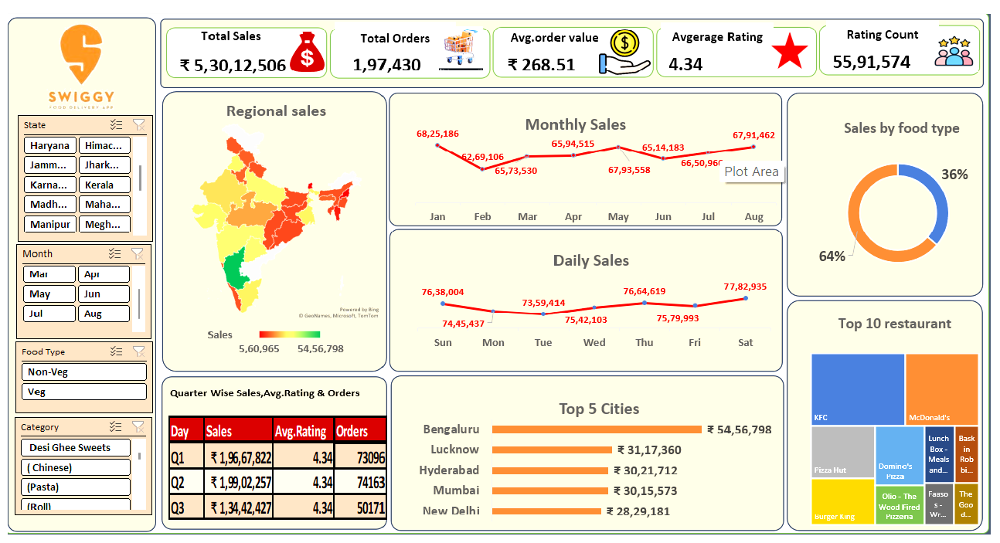

# Swiggy-Sales-Analysis
Interactive Swiggy Sales Analysis Dashboard using Microsoft Excel
## 📊 Dashboard Preview

## 📌 Project Overview

This project focuses on analyzing Swiggy sales data using Microsoft Excel.

The objective is to understand sales performance, customer preferences, restaurant performance, and regional trends through an interactive dashboard.

The dashboard helps users identify important business insights and make data-driven decisions.
## 📊 Key Business Insights

- Total Sales: ₹5,30,12,506
- Total Orders: 1,97,430
- Average Order Value: ₹268.51
- Average Customer Rating: 4.34

### Important Findings

- Bengaluru recorded the highest sales among the top 5 cities.
- KFC and McDonald's are among the leading restaurants.
- The dashboard compares Veg and Non-Veg sales.
- Monthly and daily sales trends help identify sales patterns.
- Quarterly analysis provides insights into sales, ratings, and orders.
